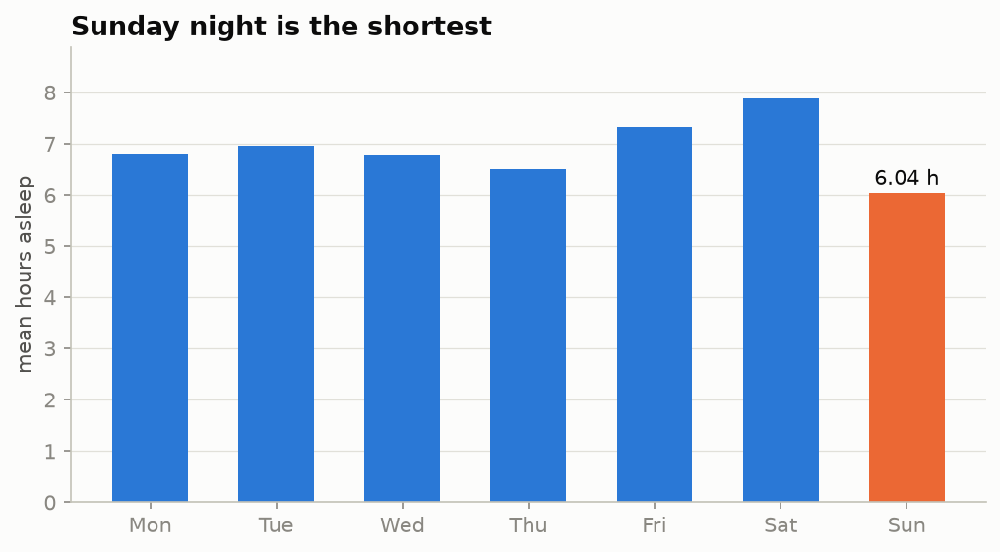
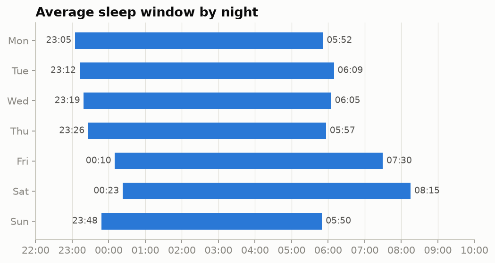
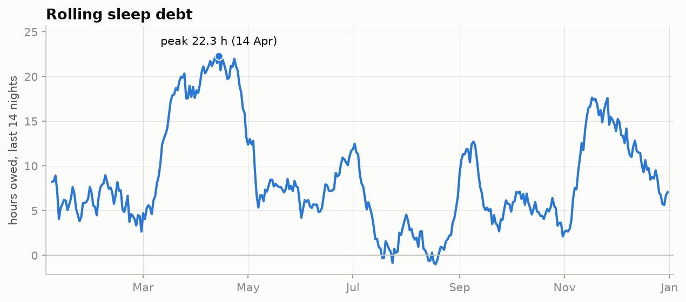
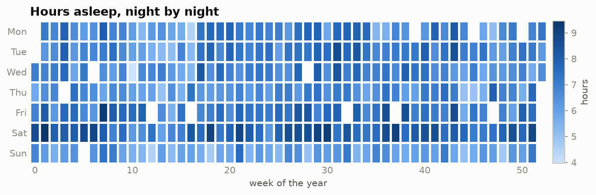
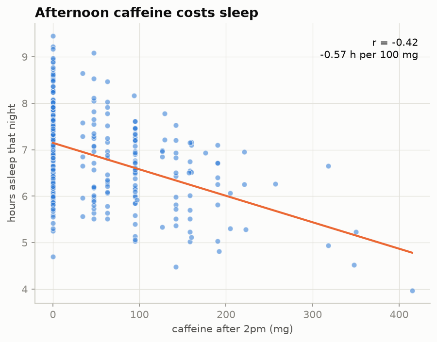
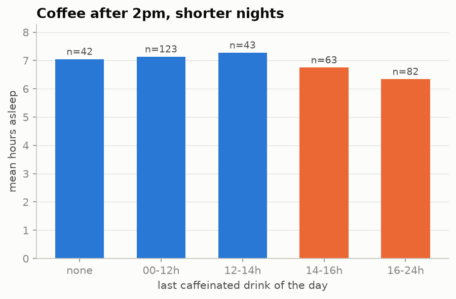

# sleep-patterns

A year of my sleep-tracker exports, poked at until they gave up some answers.

Questions I wanted answered:

- Which night of the week is actually my worst?
- How much sleep debt do I carry, and when does it pile up?
- Does my coffee habit show up in the data?

## Findings

All numbers come from `make charts` on the committed data (353 logged nights in 2025).

### Sunday is the worst night, by an hour



Sunday nights average **6.04 h**, about **60 minutes** less than every other night pooled
(permutation test, 5000 shuffles, none as extreme). Thursday is a distant second at 6.50 h.
Friday and Saturday look great only because of the lie-in.

### Weekends push the whole window later



Midsleep on Friday/Saturday nights is **85 minutes** later than on work nights. Sunday has to
snap back to a Monday alarm, so it starts late and ends early — that is most of the Sunday problem.

### Sleep debt has two seasons



Against a 7.5 h target, the rolling 14-night debt peaks at **22.3 h on 14 April** (exam season)
and climbs again through November. March and April each lose over an hour a night on average;
July and August are the only months I come close to paying it back.



### Afternoon caffeine costs sleep



| caffeine on the day | r with hours asleep | r with awakenings |
|---|---|---|
| total mg | -0.30 | +0.22 |
| mg after 2pm | **-0.42** | +0.26 |



Nights after a last drink before 2pm average 7.1–7.3 h; after 4pm, 6.3 h.
The raw slope is −34 min per 100 mg after 2pm, but busy months bring more coffee *and* less
sleep. Holding month and weekday fixed brings it to **−29 min per 100 mg** — smaller, still there.
(The generator plants −24, so even the adjusted number is a little inflated: crunch periods
don't line up neatly with calendar months.)

### What I'm changing

- Last coffee by 2pm. One espresso at 4pm is roughly a lost half hour.
- Sunday bedtime alarm at 22:45.
- Treat March/April and November as known debt seasons instead of being surprised every year.

## Setup

```sh
python -m venv .venv && source .venv/bin/activate
pip install -e ".[dev,notebooks]"

make charts   # rebuild assets/ and print the headline table
make test
jupyter lab notebooks/
```

The real export is private. `data/` holds a synthetic year generated by
`data/generate.py` with the same columns and the same kinds of mess
(missing nights, naps, a session where the watch never came off).
Rerun `make data` with a different `--seed` to get a different year.

## Layout

```
data/          synthetic sleep_log.csv + caffeine_log.csv, and the script that makes them
notebooks/     01 explore -> 02 weekday -> 03 sleep debt -> 04 caffeine -> 05 bedtime
src/sleep_patterns/
  io.py        csv loaders
  clean.py     sessions -> one row per night (naps dropped, post-midnight bedtimes fixed)
  metrics.py   weekday summary, sleep debt, social jetlag
  caffeine.py  daily caffeine, join to the following night, correlations
  plots.py     every chart in assets/
  report.py    rebuild assets/ and print the headline numbers
tests/
```
